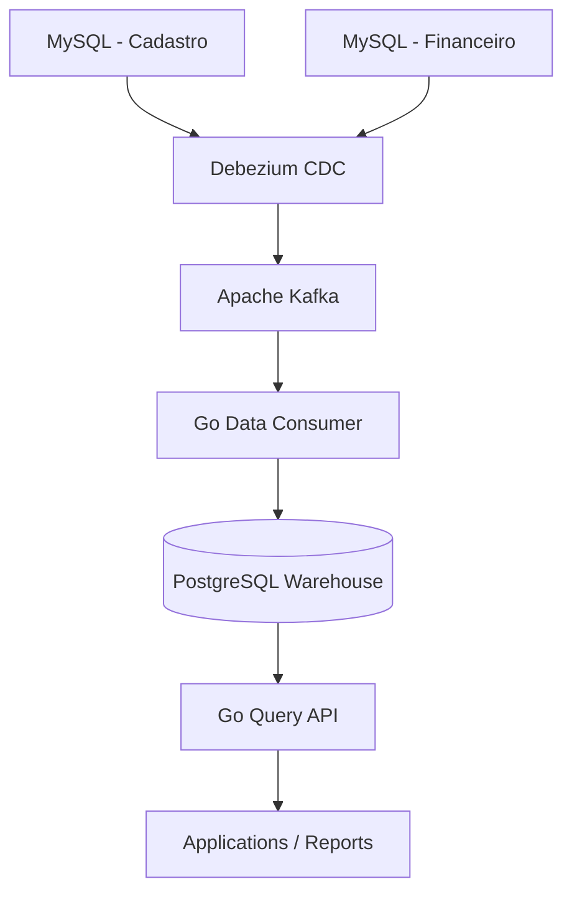

# Unified Data Platform

A real-time data integration platform built with Go, MySQL,
PostgreSQL, Apache Kafka and Debezium.

> Project status: In development

## Overview

This project demonstrates how independent operational
databases can be integrated into a unified query layer
using Change Data Capture (CDC).

The platform is designed to support cross-database
relationships, near-real-time synchronization, and
high-performance analytical and operational queries.

All data is synthetic. No production or personal data
is required.

## Architecture



## Technology Stack

| Component | Technology |
|-----------|------------|
| Source Databases | MySQL 8.4 |
| Unified Database | PostgreSQL 17 |
| CDC | Debezium |
| Event Streaming | Apache Kafka |
| Data Processing | Go |
| HTTP API | Go + Chi |
| Infrastructure | Docker Compose |
| Load Testing | k6 |
| Monitoring | Prometheus + Grafana |

## Project Goals

- Integrate independent databases.
- Capture inserts, updates, and deletes using CDC.
- Preserve relationships across different sources.
- Build a unified relational data model.
- Support operational and analytical SQL queries.
- Benchmark hundreds of queries per minute.
- Implement idempotent event processing.
- Monitor replication lag and query performance.

## Development Roadmap

- [x] Define the initial architecture
- [x] Configure local database infrastructure
- [ ] Create source and warehouse schemas
- [ ] Generate synthetic datasets
- [ ] Configure Debezium and Kafka
- [ ] Build the Go CDC consumer
- [ ] Implement data transformation and unification
- [ ] Develop the query API
- [ ] Run load and resilience tests
- [ ] Add observability and dashboards

## Running Locally

Requirements:

- Docker Engine with Docker Compose
- Git
- Go (required in later phases)

Start the database infrastructure:

```bash
cp .env.example .env
docker compose up -d
docker compose ps
```

Update the example credentials in `.env` before starting.
Database initialization steps will be documented as
the project progresses.

## Architecture Principles

- Source systems remain independent.
- Data integration uses asynchronous processing.
- Consumers must support idempotent operations.
- Data lineage and source identifiers are preserved.
- The unified database is optimized for reading.
- Components should be independently replaceable.

## License

License to be defined before the first public release.
